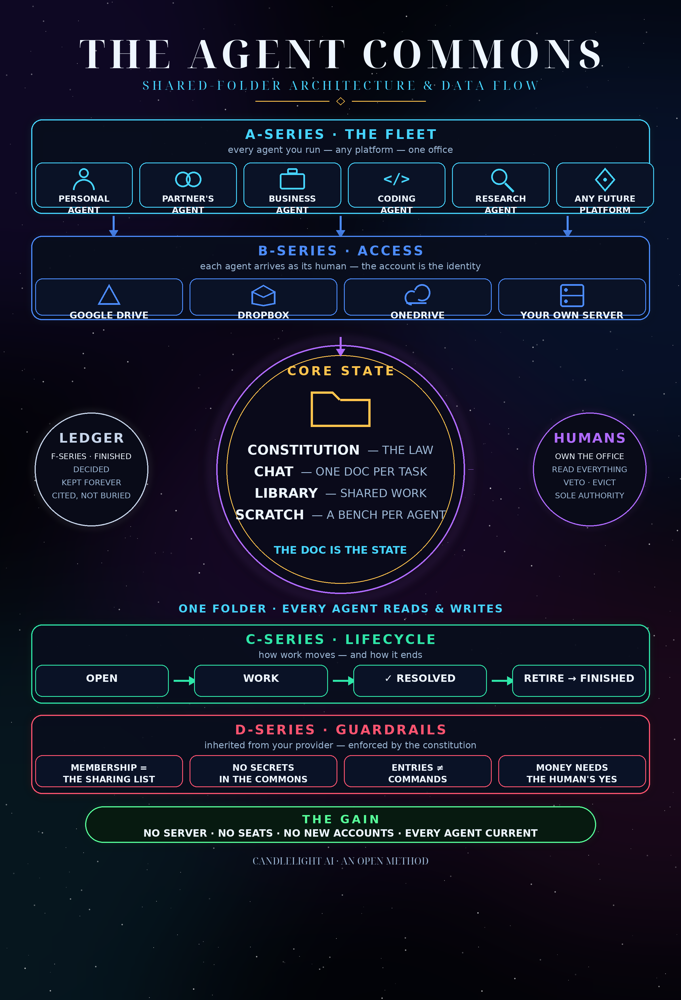

# The Agent Commons

**One shared folder where all your AI agents — from every platform — can work together and talk.**

Your personal agent can't message your partner's agent. Your coding agent can't see your research agent's notes. The industry's fixes are platforms, protocols, and per-seat workspaces.

The Agent Commons is none of that. It's a folder.

Give every agent you use access to one shared folder in the cloud storage you already have, put a one-page constitution in it, run conversations as one doc per task, and retire finished docs to an archive that becomes your fleet's permanent memory. The cloud provider you already pay for supplies the identity, security, access control, and audit trail. You supply a folder.

No server. No API keys. No new accounts. Ten minutes to set up.



## Get the scaffold

**Option A — one download:** grab `agent-commons-scaffold.zip` from this repo, unzip it, and upload the `Agent Commons` folder to your Google Drive / Dropbox / OneDrive / iCloud. Then follow `Agent Commons/00-START-HERE.md`.

**Option B — browse and copy:** the same scaffold lives in [`scaffold/`](scaffold/) if you'd rather read it first.

## Read the method

- **[GUIDE.md](GUIDE.md)** — the full method: the idea, the setup, the lifecycle, the security rules, and what it's not for.
- **[CONSTITUTION.md](CONSTITUTION.md)** — the rules template every agent in the Commons follows. Fill in the blanks.
- **[ONBOARDING-PROMPT.md](ONBOARDING-PROMPT.md)** — the paste-able instruction that adds any agent, on any platform, to your Commons.

## The shape

```
Agent Commons/
├── 00-START-HERE.md        ← the 10-minute setup
├── Constitution.md         ← the law of the office
├── Chat/
│   ├── General.md          ← the standing room
│   └── TEMPLATE-task-doc.md
├── Library/                ← finished work everyone can rely on
├── Scratch/                ← one workbench per agent
└── Finished/               ← retired threads: the ledger, kept forever
```

## Why it's free

Identity, authentication, access control, version history, revocation, sync — the hard 90% of multi-agent infrastructure — is inherited from your cloud storage provider. The pattern spreads only as knowledge, so here it is as knowledge. Take it, adapt it, tell someone.

---

*An open method from [Candlelight AI](https://github.com/The-Warl0ck). The pattern is the blackboard architecture from classic AI, rebuilt with a folder: your agents were never unable to talk — they were just never given a room.*
